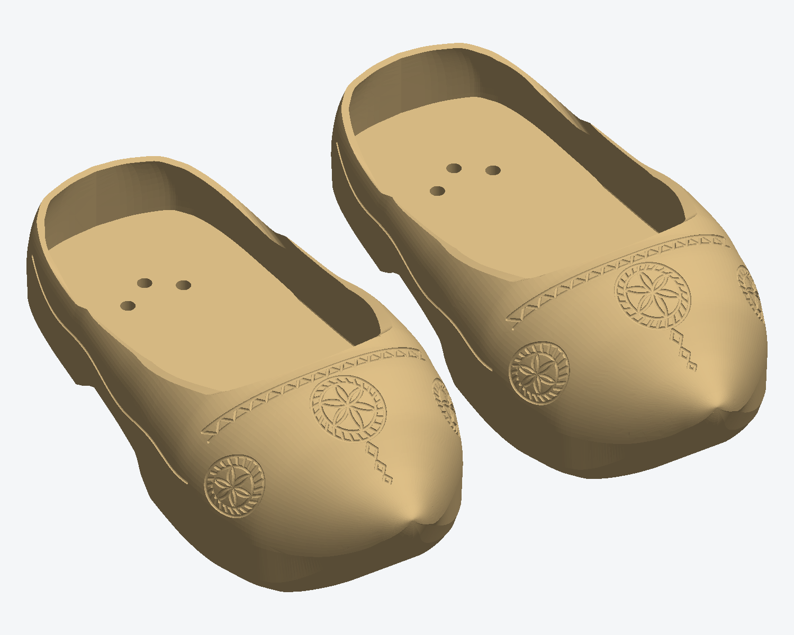
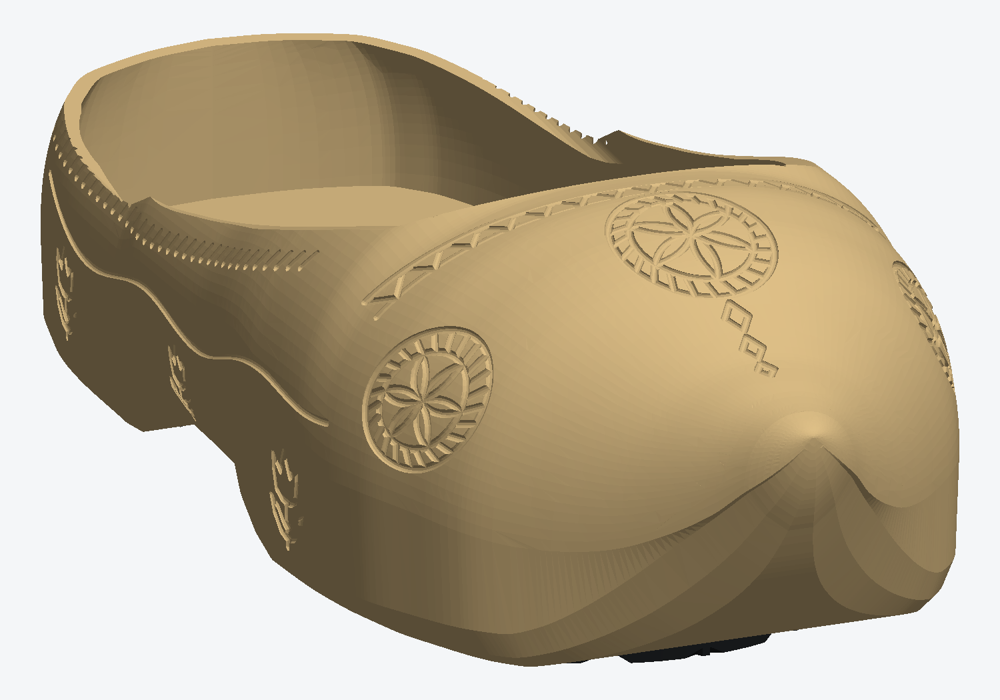
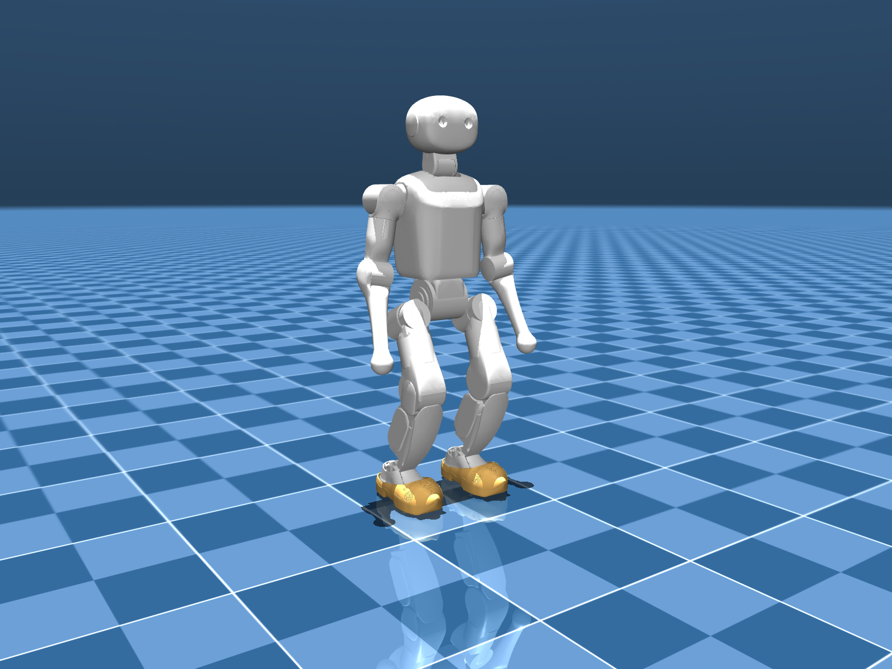
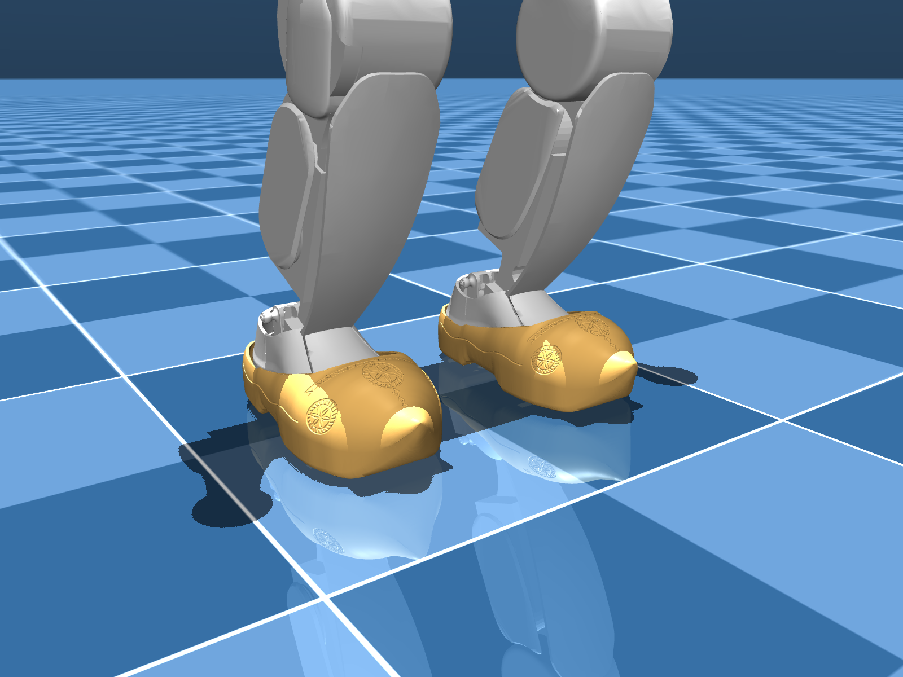

# K1 klompen

3D-printable Dutch wooden clogs (klompen) for the Booster K1 humanoid robot, made for the Humanoid Robot Fashion Challenge at Kent State University, October 2026.

The repository has the final shoe (v10 "Smooth Toe"), an ornate variant with extra carving (v11 "Ornate"), three vine versions including a light open-work pair ([vine/](vine/)), the scripts that build v10, and a MuJoCo model of the K1 wearing the clogs.



| v10 "Smooth Toe" | v11 "Ornate" |
|---|---|
|  |  |

| K1 in the clogs (MuJoCo) | Feet close-up |
|---|---|
|  |  |

## Size and weight

- 229 x 108 x 67 mm per shoe, one piece per shoe.
- About 350 g per shoe (estimate).
- The robot stands 2.2 cm taller in the clogs.

## Design

Each shoe is one printed body. The K1 foot slides in toe first and is held by three screws from below. Cast rubber pads (front and heel, from an earlier K1 shoe; their shapes are in `design/reference/*_Rubber_Insert*.step`) are glued into pockets in the sole as the ground contact. The molds for the pads are not part of this repository.

- Sole: 10 mm minimum under the arch, with a 7 mm deep arch relief. The sole curves up in one arc from the front pad to the tip.
- Upper shell: 2.4 mm.
- Pad pockets: 4 mm deep, for the rubber pads at their original size. The front pads are handed; the left and right heel pads are the same.
- Mounting: three 5.5 mm bores with 9.2 mm access holes from the underside, 4 mm of sole above the screw heads.
- Carving: rosette on the toe cap, a smaller rosette on each side, a wolf-tooth zigzag border along the opening, three diamond chips down the nose, and a scalloped side line. Grooves are 1.4 mm wide and 0.7 mm deep.
- v11 "Ornate" adds a six-petal rosette on the back of the heel, three carved tulips low on each side, and a rope border under the rim. Shape, fit, pad pockets and mounting are the same as v10.

The fit checks (foot clearance, toe-first entry, 35 ankle poses, pad fit) are in [design/FIT_REPORT.md](design/FIT_REPORT.md) and [design/validation.json](design/validation.json). More design notes are in [design/README.md](design/README.md).

## Printing

Print files (100% scale, millimetres):

- v10: [design/Print_Shoes/K1_Left_Klomp_One_Piece.stl](design/Print_Shoes/K1_Left_Klomp_One_Piece.stl), [design/Print_Shoes/K1_Right_Klomp_One_Piece.stl](design/Print_Shoes/K1_Right_Klomp_One_Piece.stl)
- v11: [ornate-v11/Print_Shoes/](ornate-v11/Print_Shoes/)
- vine versions: [vine/Print_Shoes/](vine/Print_Shoes/)

Material: PETG. Settings for infill of 50% or less:

- Perimeters: at least 5 walls. With a 0.4 mm nozzle, 6 walls fill the 2.4 mm upper completely.
- Top/bottom: at least 6 layers, so the sole skin and the area around the bores print solid.

The inside of the vamp is an overhang. Either print upright with tree supports inside the toe, or stand the shoe on its heel, toe up, with a brim.

### Putting the shoe on

1. Tip the robot's heel up about 8 degrees and slide the toe under the vamp.
2. Drop the heel into the shoe.
3. Fit the three screws from below.
4. Glue the rubber pads into the pockets in the sole (they fit in from below).

Not tested yet: physical fit on the robot, PETG strength while walking, clearance to cables and other links.

## Viewing in MuJoCo

```
pip install mujoco numpy
cd sim
python view.py            # on macOS: mjpython view.py
```

`view.py` opens `sim/K1_22dof_clogs.xml` and holds the robot in its "stand" pose. Collision hulls are hidden; press 3 in the viewer to show them.

Models in `sim/`:

- `K1_22dof_clogs.xml`: MuJoCo model of the K1 with the clogs, with a "stand" keyframe.
- `K1_22dof_clogs.urdf`: the same as URDF. `K1_Left_Klomp.urdf`: one shoe alone.
- `mjlab/k1_clogs.xml`: a variant of the booster_mjlab K1 model for mjlab training. The clog collision geoms keep the names `left_foot_collision` / `right_foot_collision`, and the clog mass is merged into the foot link.
- `K1_22dof.xml`, `K1_22dof.urdf`: the K1 model without clogs.

Each clog weighs 0.35 kg in the model; the K1 with clogs weighs 20.37 kg in `K1_22dof_clogs.xml`.

In simulation, a dance policy trained barefoot also runs in the clogs without falling; body tracking error is 4.94 cm in the clogs vs 4.86 cm barefoot. The videos are in `sim/videos/`.

## Rebuilding

The shoe:

```
cd design
pip install -r requirements.txt
python build.py
```

This writes the print STLs, the preview images and `validation.json`. It builds v10.

The sim models (meshes, URDF, MJCF):

```
cd sim
pip install mujoco trimesh numpy
python build_clogs.py                       # v10 from design/Print_Shoes/
python build_clogs.py --shoe ../ornate-v11/Print_Shoes/K1_Left_Klomp_One_Piece_v11_Ornate.stl   # v11
```

To also write `mjlab/k1_clogs.xml`, set `BOOSTER_K1_XML` to the `booster_k1/xmls/k1.xml` file of a booster_mjlab checkout:

```
BOOSTER_K1_XML=/path/to/booster_mjlab/src/booster_mjlab/robots/booster_k1/xmls/k1.xml python build_clogs.py
```

Other scripts in `sim/`: `render_stills.py` (the still images in `sim/renders/`), `render_rollout.py` (renders a rollout CSV to video), `clog_eval.py` (runs an mjlab policy evaluation with the clogs on; it needs mjlab, booster_mjlab and an evaluation script that is not included, see the file header).

## Layout

```
design/              v10 shoe: build.py, helpers, print STLs, previews, fit report
  Print_Shoes/       left and right print STLs
  reference/         K1 foot meshes, rubber pad STEP files, foot registration
ornate-v11/          v11 "Ornate": print STLs, previews, sim renders
vine/                vine versions (open-work, relief, full): print STLs, renders
sim/                 K1 with the clogs: MuJoCo XML, URDF, meshes, mjlab variant, renders, videos, scripts
```

## License

- Shoe designs, STL and STEP files of the clogs, preview images, renders and videos: [CC BY 4.0](LICENSE-CC-BY-4.0).
- Scripts (`*.py`): [MIT](LICENSE).
- The Booster K1 robot meshes and models (the K1 meshes in `sim/meshes/` and `design/reference/`, `sim/K1_22dof.*`, and the robot parts of `sim/K1_22dof_clogs.*` and `sim/mjlab/k1_clogs.xml`) belong to Booster Robotics and stay under their license: [design/reference/Booster_Assets_LICENSE](design/reference/Booster_Assets_LICENSE).

## Author

Kyrylo Kolesnichenko, Advanced Telerobotics Research Lab, Kent State University.
https://kyry.me
