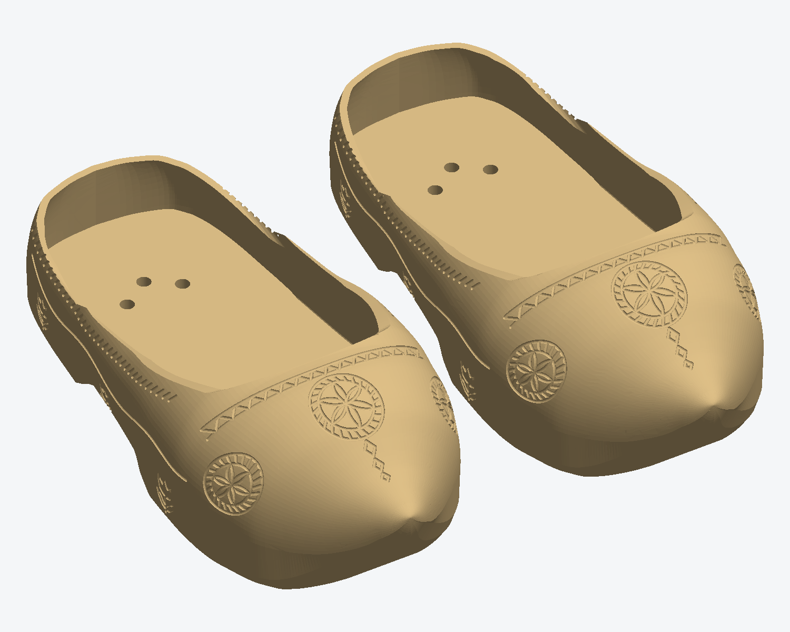
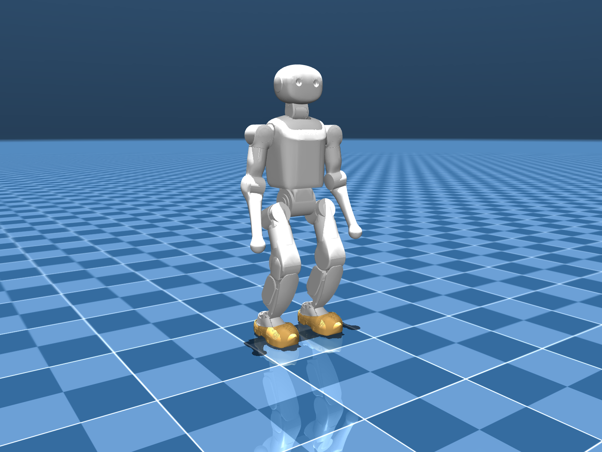

# v11 "Ornate"

The v10 "Smooth Toe" clog with extra carving: a six-petal rosette on the back of the heel, three carved tulips low on each side, and a rope border under the rim. Shape, fit, pad pockets and the 3-screw mounting are the same as v10, so the printing settings and the steps for putting the shoe on in the main README apply unchanged.

Size 229 x 108 x 67 mm, about 350 g per shoe (estimate), robot 2.2 cm taller.

- `Print_Shoes/`: left and right print STLs, millimetres, print at 100% scale in PETG.
- `previews/`: design previews.
- `renders/`: the K1 wearing the v11 clogs in MuJoCo.

To view v11 in MuJoCo, rebuild the sim model with this STL (this overwrites the v10 clog meshes in `sim/meshes/`):

```
cd ../sim
python build_clogs.py --shoe ../ornate-v11/Print_Shoes/K1_Left_Klomp_One_Piece_v11_Ornate.stl
python view.py
```



