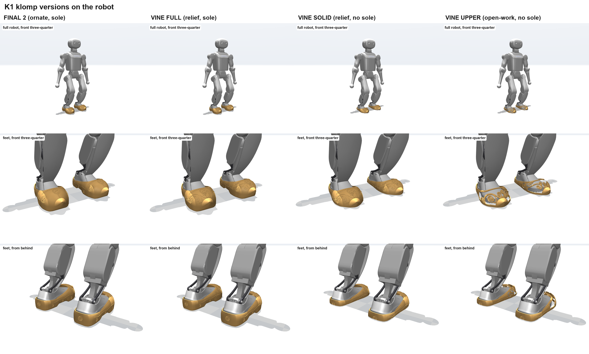
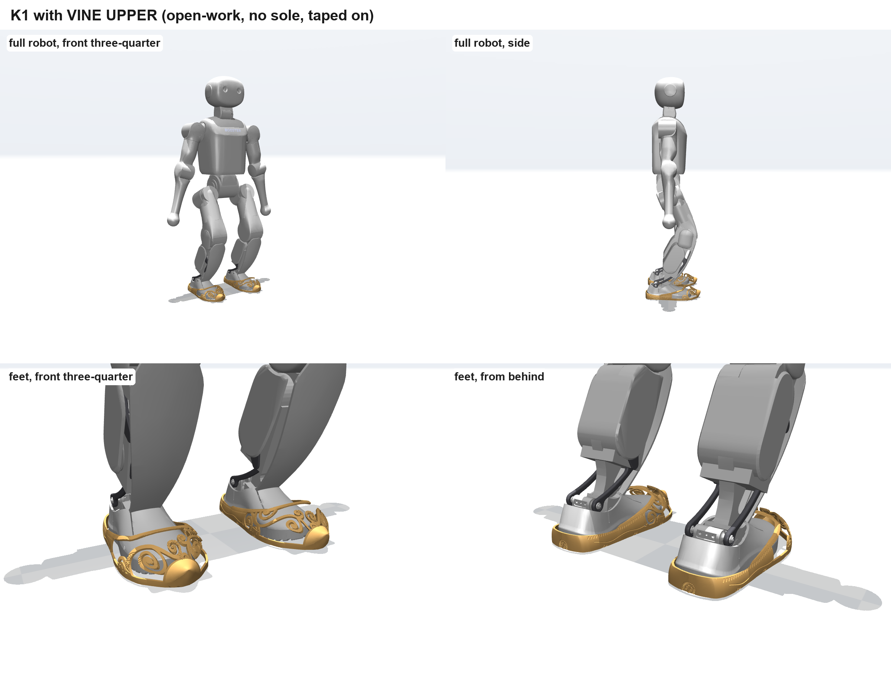

# Vine versions

Clogs with carved vines, on the same fit and foot registration as v10. Three versions:

| version | what | size (L x W x H) | solid volume, left shoe |
|---|---|---|---|
| VINE UPPER | open-work vines only, no sole: the light pair | 229 x 108 x 47 mm | 31 cm³ |
| VINE SOLID | closed upper with vines in relief, no sole | 229 x 110 x 47 mm | 50 cm³ |
| VINE FULL | vines in relief on the full clog with sole | 229 x 110 x 67 mm | 297 cm³ |

Print files (millimetres, 100% scale) are in `Print_Shoes/`, left and right for each version.
Volumes are of the meshes, not printed weights.

There is no sim model or build script for these versions in this repository; the sim model in
`../sim/` is v10.
